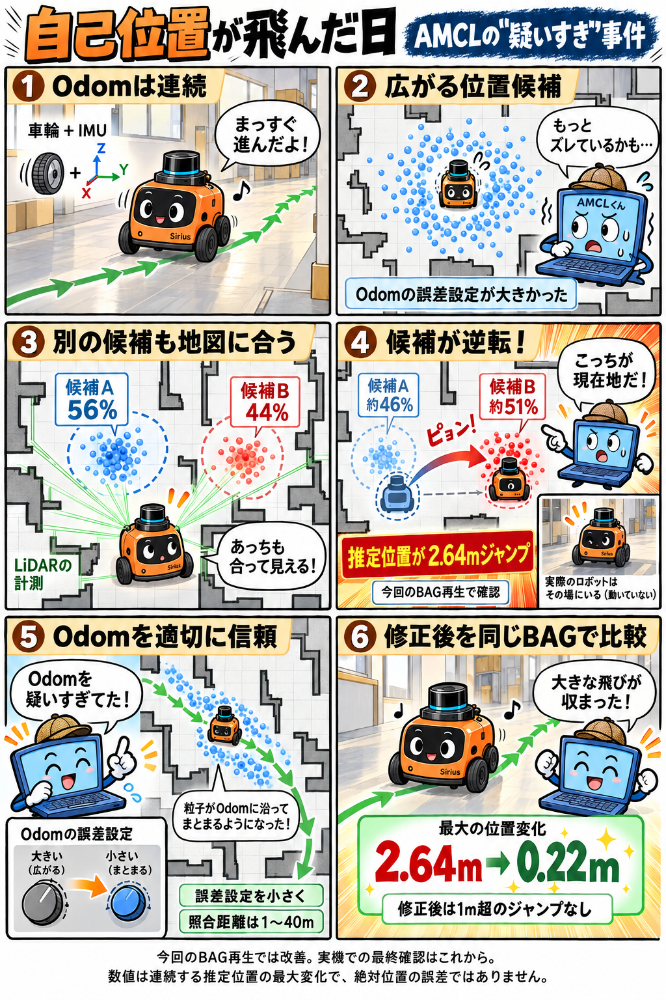

# AMCLの自己位置ジャンプ：解析と採用設定

2026-11-02に、`rosbag_20261025_125115`を実機から隔離して再生し、AMCL内部の粒子・重み・スキャン採点を調べました。

## 採用した設定

実機用の通常・セマンティック両設定で、以下を採用しています。

| パラメータ | 旧設定 | 採用値 |
|---|---:|---:|
| alpha1 / alpha2 | 0.10 | 0.005 |
| alpha3 / alpha4 | 0.15 | 0.02 |
| laser_min_range | -1（スキャン側の値） | 1m |
| laser_max_range | 100m | 100mを維持 |

対象ファイル：

- [通常の実機設定](../../params/nav2_params.yaml)
- [セマンティックの実機設定](../../params/nav2_params_semantic.yaml)

Odom自体を変更する処理ではありません。Odomによって粒子を移動させる際の散らばりを小さくし、良好な車輪＋IMUの相対移動をより信頼する設定です。

## 同じBAGでの比較

| 比較条件 | 最大の連続位置変化 | 1m超のジャンプ |
|---|---:|---:|
| 当時の設定 | 2.64m | 2回 |
| Odom誤差設定だけ低減（距離上限100m・最小距離は旧設定） | 0.16m | 0回 |
| Odom誤差低減＋距離1〜40m | 0.22m | 0回 |
| 距離1〜40mへの制限だけ | 6.44m | 7回 |

最大変化は連続する推定位置間の距離であり、絶対位置の誤差ではありません。上限100mと最小1mを併用する最終設定そのものは、この比較では個別に再生していません。

**漫画は、上限40mだった比較時点の結果を描いています。** その後、遠方の建物なども照合に使えるよう上限100mを採用しました。距離制限だけでは改善せず、主に有効だったのはOdom誤差設定の低減です。

## 確認できたこと・限界

- 粒子の候補群の重みがA56%/B44%から約A46%/B51%へ逆転し、選ばれる群が変わった瞬間に2.64m飛びました。
- OdomのXY原点だけをゼロにしても、更新時刻と推定軌跡は数値誤差内で一致しました。
- 計測処理を加えたAMCLと未改変AMCLの出力146件は完全一致しました。
- 実機に記録された約6.64mのジャンプと、今回再生した2.64mのジャンプは、同一の粒子履歴の完全再現ではありません。実機の粒子群・生の3D点群が未記録のため、物理的な環境要因まで一意に確定できません。
- 番号の異なる反復は独立した乱数試行ではありません。今回の結果だけで、車輪滑りを含む別環境や長時間走行での再発防止は保証できません。

[比較値のJSON](replay-summary.json) / [図・粒子を見られるWeb解析ページ（Tailscale接続が必要）](https://kotantu-desktop-system-product-name.tail6e1aa.ts.net:8444/static/amcl-trace-20261102/index.html)

設定ファイルはDesktop・NUCに反映済みです。今回の変更でNav2の再起動・実機への速度指令・InitialPose送信はしていません。次回Nav2起動時に読み込まれます。
